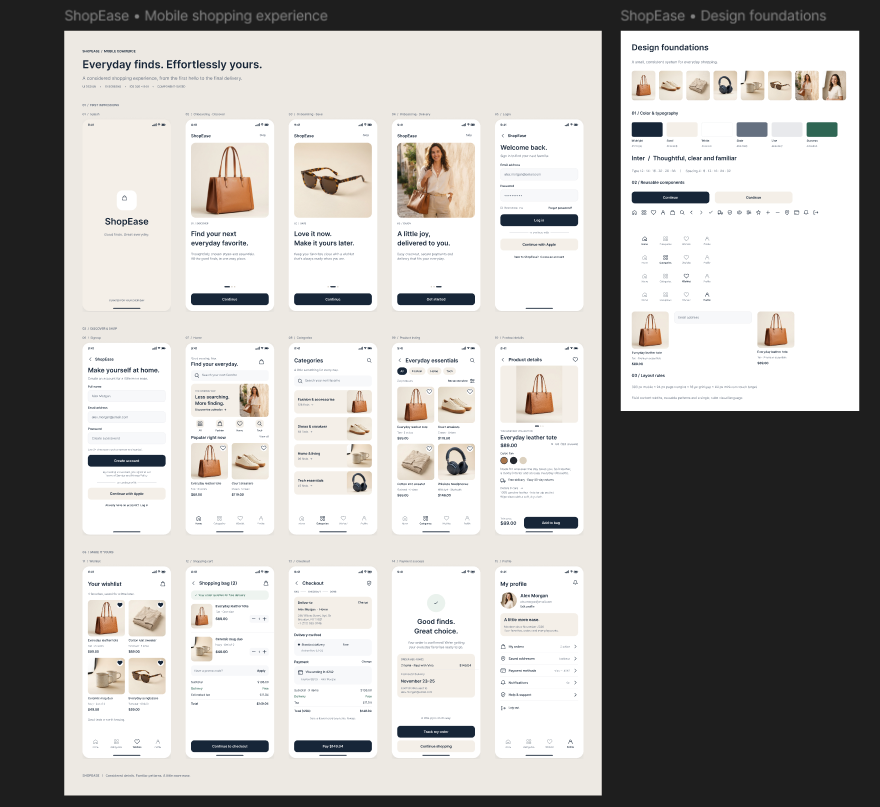

# ShopEase – Mobile Shopping App UI/UX Design

A mobile shopping app design focused on a calm, consistent experience from the first launch to final delivery. Designed in **Figma**.

## Overview

ShopEase is a 15-screen mobile e-commerce experience for everyday shopping. The goal was a simple, uncluttered flow that helps a user discover products, save favourites and check out with as few steps as possible.

## Screens

| Flow | Screens |
|---|---|
| First impressions | Splash, three onboarding screens, login |
| Discovery | Sign-up, home, categories, product listing, product details |
| Make it yours | Wishlist, shopping bag, checkout, payment success, profile |

## Design foundations

- **Colour:** navy, sand, white, slate, light grey and green accent
- **Typography:** Inter, with a clear and familiar scale
- **Components:** reusable buttons, inputs, cards, tab bar and icon set
- **Layout:** consistent spacing and grid rules across all screens

## Tools

Figma

## Author

Swetha Maruthaiyan
[LinkedIn](https://www.linkedin.com/in/swetha-maruthaiyan)
